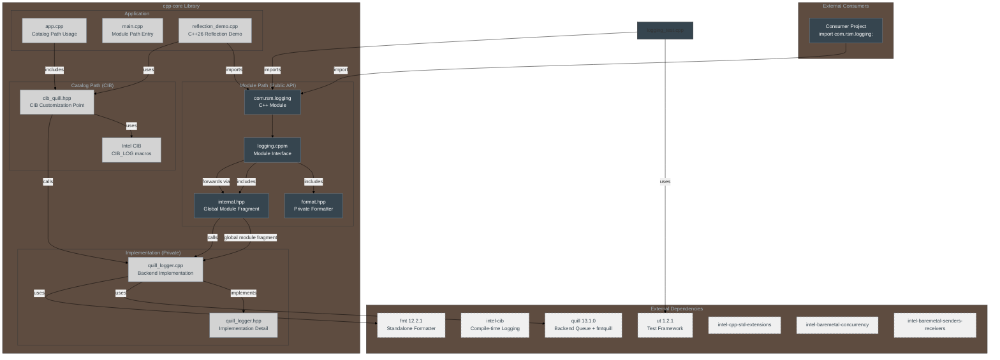
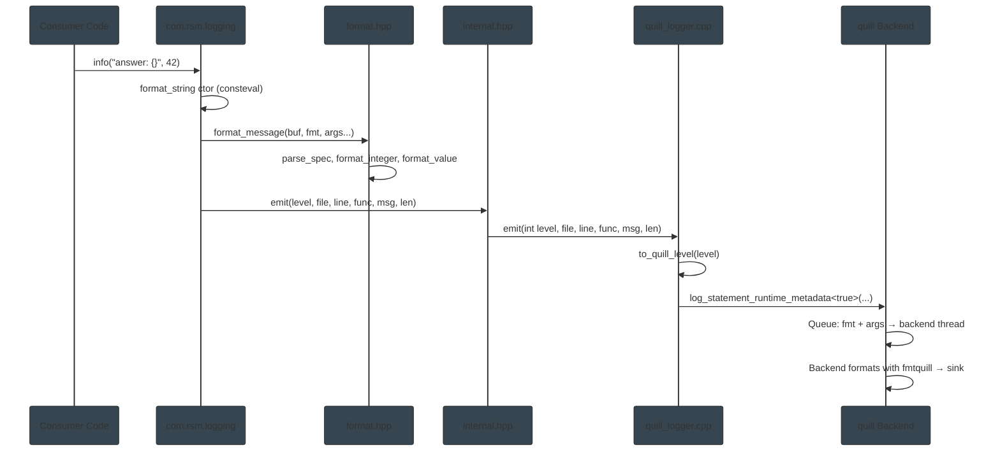
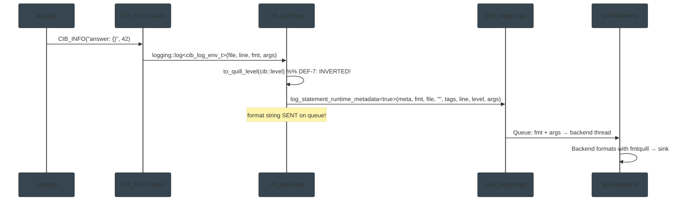
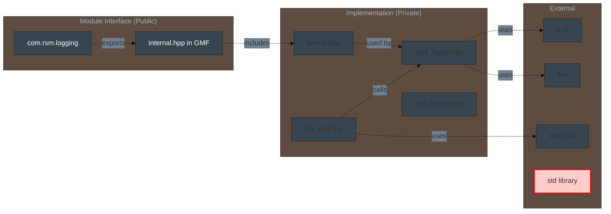

# Component Diagram — cpp-core Architecture

> **System components, modules, data flow, and boundaries**  
> Theme: Modern Minimalist | Part of [Architecture Documentation](../../README.md)

---

## 🏗️ High-Level Component View



---

## 📦 Component Responsibilities

| Component | Type | Responsibility | Public? |
|-----------|------|----------------|---------|
| `com.rsm.logging` | C++ Module | Public API: `info()`, `warning()`, `error()`, `trace()`, `debug()`, `critical()`, `log()`, `log_raw()`, `setup()`, `flush()`, `set_level()`, `current_level()` | ✅ Yes |
| `logging.cppm` | Module Interface | Exports module, defines `level` enum, `format_string` class, forwarding functions | ✅ Yes (BMI) |
| `format.hpp` | Private Header | Hand-rolled constexpr formatter (492 lines), format spec parsing, integer/float formatting | ❌ No (PRIVATE) |
| `internal.hpp` | Global Module Fragment | Standard-library-free interface: 6 level constants + 6 functions (`start_logger`, `flush_logger`, `set_log_level`, `get_log_level`, `emit`, `format_double`) | ❌ No (GMF) |
| `cib_quill.hpp` | CIB Customization | Implements CIB's `logging::config<>` specialization, catalog path level mapping, `decay_enum_value` | ❌ No (internal) |
| `quill_logger.cpp` | Implementation | Quill backend: logger creation, `log_statement_runtime_metadata`, level mapping, `format_double` | ❌ No (PRIVATE source) |
| `quill_logger.hpp` | Impl Detail | Single declaration: `quill_logger() -> quill::Logger*` | ❌ No (implementation detail) |
| `app.cpp` | Application | Catalog path usage: `CIB_INFO`, `CIB_WARN`, `CIB_ERROR` + calls reflection demo | ❌ No (object lib) |
| `main.cpp` | Entry Point | Module path: `import com.rsm.logging; setup(); flush()` | ❌ No (executable) |
| `reflection_demo.cpp` | Demo | C++26 static reflection: `import com.rsm.logging; <meta>` | ❌ No (separate TU) |

---

## 🔄 Data Flow — Module Path



---

## 🔄 Data Flow — Catalog Path



---

## 🚫 Boundary Rules (Enforced)



| Rule | Enforcement | Status |
|------|-------------|--------|
| Module interface includes no `<xxx>` standard headers | `internal.hpp` has zero includes | ✅ Enforced |
| `format.hpp` is PRIVATE source | `target_sources(... PRIVATE format.hpp)` | ✅ Enforced |
| `quill_logger.hpp` not in module BMI | Not in `FILE_SET CXX_MODULES` | ✅ Enforced |
| `format_double` only in implementation | Only in `quill_logger.cpp` | ✅ Enforced |
| Catalog path outside module | `app.cpp` includes `cib_quill.hpp`, no import | ✅ Enforced |

---

## 📐 Module Interface Surface

```mermaid
%%{init: {'theme': 'base', 'themeVariables': { 'primaryColor': '#36454f', 'secondaryColor': '#708090' }}}%%
classDiagram
    class com.rsm.logging {
        +enum class level : unsigned char { trace, debug, info, warning, error, critical }
        +template<Wrapped...> class format_string
        +setup() void
        +flush() void
        +set_level(level) void
        +current_level() level
        +log_raw(level, msg, len) void
        +log(format_string, Args...) void
        +trace(format_string, Args...) void
        +debug(format_string, Args...) void
        +info(format_string, Args...) void
        +warning(format_string, Args...) void
        +error(format_string, Args...) void
        +critical(format_string, Args...) void
    }

    class format_string<Wrapped...> {
        +consteval format_string(char const*, source_location...)
        +text: char const*
        +length: unsigned long
        +file: char const*
        +line: unsigned
        +function: char const*
    }

    class detail {
        +start_logger() void
        +flush_logger() void
        +set_log_level(int) void
        +get_log_level() int
        +emit(int, file, line, func, msg, len) void
        +format_double(double, char, int, char*, ulong) ulong
    }

    com.rsm.logging ..> format_string : uses
    com.rsm.logging ..> detail : forwards to
```

---

## 🔑 Key Architectural Decisions (Visual Summary)

| Decision | Diagram Reference | Impact |
|----------|-------------------|--------|
| **Dual-path architecture** | Two parallel flows in component diagram | Module path = constexpr, Catalog path = structured logging |
| **Standard-library-free module** | `internal.hpp` in GMF, zero includes | Enables `import com.rsm.logging;` without collisions |
| **format.hpp is PRIVATE** | Not in BMI, only in module purview | Hand-rolled formatter hidden from consumers |
| **Catalog path outside module** | `app.cpp` uses `cib_quill.hpp`, no import | CIB macros work; structured logging via types |
| **Two fmt copies** | `fmt` (standalone) + `fmtquill` (bundled in quill) | Structural, not accidental — custom formatters for `fmt` only |

---

## 📖 Related Documentation

| Document | Focus |
|----------|-------|
| [02-wire-protocol.md](02-wire-protocol.md) | Quill wire format vs catalog-typed proposal |
| [03-sequence-diagrams.md](03-sequence-diagrams.md) | Detailed runtime flows |
| [04-dependency-graph.md](04-dependency-graph.md) | All external dependencies with versions |
| [../cxx26-features-audit/README.md](../cxx26-features-audit/README.md) | Full audit (21 parts) |

---

*Part of the cpp-core Architecture Documentation Suite — [Back to Index](../../README.md)*