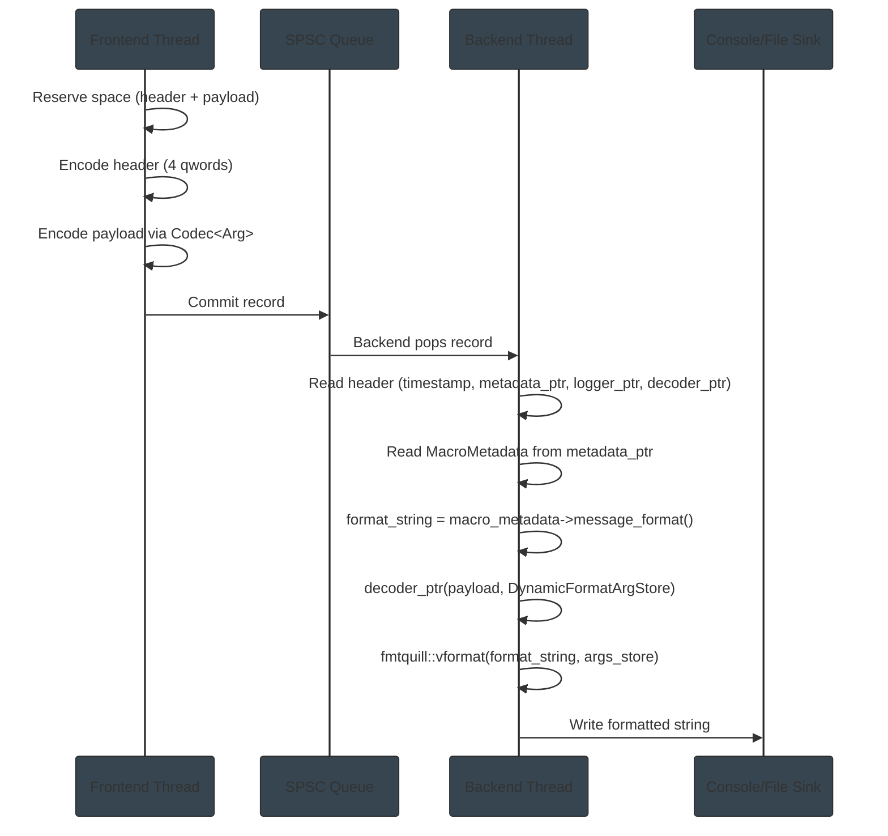
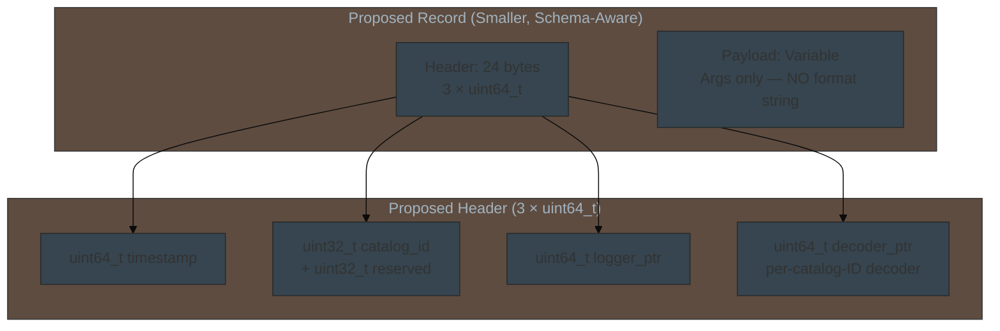

# Wire Protocol — Quill vs Catalog-Typed Proposal

> **What goes on the queue today vs. the catalog-typed structured logging vision**
> Theme: Modern Minimalist | Part of [Architecture Documentation](../../README.md)

---

## 🎯 Executive Summary

| Aspect | Quill Today | Catalog-Typed Proposal |
|--------|-------------|------------------------|
| **Queue payload** | Format string + encoded arguments | **Only encoded arguments** (catalog ID identifies schema) |
| **Format string location** | In `MacroMetadata` (compile-time, pointed to by header) | **Never on wire** — only in catalog (compile-time type) |
| **Schema evolution** | Implicit (format string in binary) | **Explicit** — catalog ID = schema version |
| **Backend work** | fmtlib formats at runtime | **fmtlib deserializes** from catalog schema |
| **Wire size** | Header (32B) + fmt string + args | **Header (24B) + args only** |

---

## 📦 Quill 13.1.0 Wire Format (Current)

### Record Structure

```mermaid
%%{init: {'theme': 'base', 'themeVariables': { 'primaryColor': '#36454f', 'secondaryColor': '#708090' }}}%%
graph TB
    subgraph "Queue Record (Variable Length)"
        HEADER[Header: 32 bytes<br/>4 × uint64_t]
        PAYLOAD[Payload: Variable<br/>Per-arg Codec encoding]
    end

    subgraph "Header (4 × uint64_t)"
        TS[uint64_t timestamp<br/>rdtsc() or system time]
        META[uint64_t metadata_ptr<br/>&MacroMetadata]
        LOGGER[uint64_t logger_ptr<br/>&LoggerImpl]
        DECODER[uint64_t decoder_ptr<br/>&FormatArgsDecoder]
    end

    subgraph "MacroMetadata (compile-time, not on queue)"
        META_FMT[char const* message_format<br/>The format string!]
        META_FILE[char const* source_location<br/>file:line]
        META_FUNC[char const* caller_function]
        META_TAGS[char const* tags]
        META_LEVEL[LogLevel log_level]
        META_EVENT[Event type]
    end

    HEADER --> TS
    HEADER --> META
    HEADER --> LOGGER
    HEADER --> DECODER
    META -.->|points to| META_FMT
```

### Header Layout (32 bytes fixed)

| Offset | Size | Field | Source |
|--------|------|-------|--------|
| 0 | 8 | `timestamp` | `rdtsc()` or system time |
| 8 | 8 | `metadata_ptr` | `reinterpret_cast<uintptr_t>(&MacroMetadata)` |
| 16 | 8 | `logger_ptr` | `reinterpret_cast<uintptr_t>(LoggerImpl*)` |
| 24 | 8 | `decoder_ptr` | `reinterpret_cast<uintptr_t>(FormatArgsDecoder)` |

### Payload Encoding (per `Codec<Arg>`)

| Type Category | Encoding |
|---------------|----------|
| Arithmetic, enum, `void*`, `void const*` | `memcpy` of `sizeof(Arg)` |
| `char[N]` | `uint32_t` len (cached) + bytes + `\0` |
| `char*` / `char const*` | `uint32_t` len (cached, includes `\0`) + bytes + `\0` |
| `std::string` / `std::string_view` | `uint32_t` len + bytes |
| Other | **Compile error** (`codec_not_found_for_type`) |

### Backend Processing Flow



---

## 🎯 Catalog-Typed Proposal (Target)

### Core Idea

> **Compile-time:** Each distinct `(format string + parameter types)` → unique **catalog ID** (a type, e.g., `sc::undefined<sc::args<Args...>, -1, ...>`).
> **Runtime:** Queue carries **only encoded arguments** + **catalog ID**.
> **Backend:** Looks up schema by catalog ID, uses fmtlib to **deserialize** into typed fields.

### Proposed Record Structure



### Header Comparison

| Field | Quill Today | Catalog-Typed |
|-------|-------------|---------------|
| Timestamp | 8 bytes | 8 bytes |
| Metadata pointer | 8 bytes (`MacroMetadata*`) | **4 bytes (catalog_id) + 4 reserved** |
| Logger pointer | 8 bytes | 8 bytes |
| Decoder pointer | 8 bytes | 8 bytes |
| **Total** | **32 bytes** | **24 bytes** |
| Format string | In `MacroMetadata` (off-queue) | **Never on wire** |

---

## 🔄 The Delta — What Changes

```mermaid
%%{init: {'theme': 'base', 'themeVariables': { 'primaryColor': '#36454f', 'secondaryColor': '#708090' }}}%%
graph LR
    subgraph "Current (Quill)"
        C1[Format string in MacroMetadata]
        C2[Header: 32B]
        C3[Payload: fmt_str + args]
        C4[Backend reads fmt from metadata_ptr]
        C5[fmtlib formats at runtime]
    end

    subgraph "Proposed (Catalog)"
        P1[Format string in catalog type only]
        P2[Header: 24B (-8B)]
        P3[Payload: args only]
        P4[Backend looks up schema by catalog_id]
        P5[fmtlib deserializes from schema]
    end

    C1 -.->|REMOVED| P1
    C2 -.->|SHRINKS| P2
    C3 -.->|SHRINKS| P3
    C4 -.->|CHANGES| P4
    C5 -.->|CHANGES| P5
```

---

## 🔑 The Key Unknown: QUIL-1

> **Can a `quill::Codec` push N fields from one pack element?**

### Current `Codec` Design (per-type)

```cpp
// quill/core/Codec.h:164-354
template <typename Arg, typename = void>
struct Codec {
    static size_t compute_encoded_size(SizeCacheVector&, Arg const&) noexcept;
    static void encode(byte*&, SizeCacheVector const&, uint32_t&, Arg const&) noexcept;
    static auto decode_arg(byte*&) -> Arg;
    static void decode_and_store_arg(byte*&, DynamicFormatArgStore*);
};
```

- **Per-type**: One `Codec<int>`, one `Codec<double>`, etc.
- **Per-argument**: Each `Args...` element gets its own `Codec` instantiation
- **Pack expansion**: `(Codec<Arg>::encode(...), ...)` — one encode per argument

### Catalog-Typed Requirement

```cpp
// What we NEED:
struct CatalogMessage {
    uint32_t catalog_id;
    // N fields packed as one "argument"
    int field1;
    double field2;
    std::string field3;
};

// Need: Codec<CatalogMessage> that encodes N fields as N separate arguments
template <>
struct Codec<CatalogMessage> {
    static size_t compute_encoded_size(...) { /* sum of N fields */ }
    static void encode(...) { /* encode field1, field2, field3 as SEPARATE args */ }
    static void decode_and_store_arg(byte*&, DynamicFormatArgStore*) {
        // Push field1, field2, field3 as 3 SEPARATE args into DynamicFormatArgStore
    }
};
```

### Why This Matters

| If QUIL-1 = YES | If QUIL-1 = NO |
|-----------------|----------------|
| Single `Codec` per catalog message type | Need N separate `Codec` instantiations per message |
| One decoder per catalog ID | Decoder must be generated per message (complex) |
| Catalog message = one queue record | Message splits across records (breaks atomicity) |
| **Step 7 (move formatting out) UNBLOCKED** | **Step 7 BLOCKED** — need fallback (a) or (b) |

### Current Workaround (What cib_quill.hpp Does Today)

```cpp
// cib_quill.hpp:157-159 — STILL SENDS FORMAT STRING!
quill_logger()->template log_statement_runtime_metadata<true>(
    &metadata, fmt.c_str(), file, "", tags.c_str(), line, level, decayed_args...);
```

- Uses `LogWithRuntimeMetadataDeepCopy` event
- **Sends format string on queue** (`fmt.c_str()` encoded as `char const*`)
- Not catalog-typed — just runtime metadata path

---

## 🔧 Files That Would Change

| File | Change Type | Description |
|------|-------------|-------------|
| `quill/core/Codec.h` | **Add** | Catalog message `Codec` specialization pattern |
| `quill/Logger.h` | **Add** | `log_statement_catalog(catalog_id, args...)` overload |
| `quill/backend/BackendWorker.h` | **Modify** | `_write_log_statement` → catalog-aware path |
| `cpp-core/include/cpp-core/logging/cib_quill.hpp` | **Replace** | Call new catalog path instead of `log_statement_runtime_metadata` |
| `cmake/catalog.cmake` | **Extend** | Generate catalog ID → schema mapping for backend |

---

## 📏 Wire Size Comparison (Example)

```text
Message: LOG("User {name} logged in from {ip}", name, ip)
Args: name="alice" (5 bytes), ip="192.168.1.1" (11 bytes)

QUILL TODAY:
  Header: 32 bytes
  Format string: "User {} logged in from {}" = 28 bytes + 1 = 29 bytes
  Arg1 (name): len=5 + 5 bytes + 1 = 11 bytes
  Arg2 (ip):   len=11 + 11 bytes + 1 = 23 bytes
  TOTAL: 32 + 29 + 11 + 23 = 95 bytes

CATALOG-TYPED:
  Header: 24 bytes
  Catalog ID: 4 bytes (in header)
  Arg1 (name): 11 bytes
  Arg2 (ip):   23 bytes
  TOTAL: 24 + 11 + 23 = 58 bytes (39% smaller)
```

---

## 📖 Source References

All Quill internals read from installed headers:

```text
/<vcpkg_installed>/include/quill/
  core/MacroMetadata.h          (compile-time metadata, has format string)
  core/DynamicFormatArgStore.h  (holds decoded fmtquill::basic_format_arg)
  core/Codec.h                  (per-type encode/decode, payload format)
  Logger.h                      (queue encoding, log_statement, log_statement_runtime_metadata)
  LogMacros.h                   (macro expansion, MacroMetadata creation)
  backend/BackendWorker.h       (backend formatting, sink write)
```

**No build, no compiler, no CMake** — read from installed headers only. The lane is parked.

---

## 📖 Related Documentation

| Document | Focus |
|----------|-------|
| [01-component-diagram.md](01-component-diagram.md) | System components and data flow |
| [03-sequence-diagrams.md](03-sequence-diagrams.md) | Detailed runtime flows |
| [../cxx26-features-audit/quill-wire-format-comparison.md](../cxx26-features-audit/quill-wire-format-comparison.md) | Full audit research |
| [04-dependency-graph.md](04-dependency-graph.md) | Quill version and dependency details |

---

*Part of the cpp-core Architecture Documentation Suite — [Back to Index](../../README.md)*
