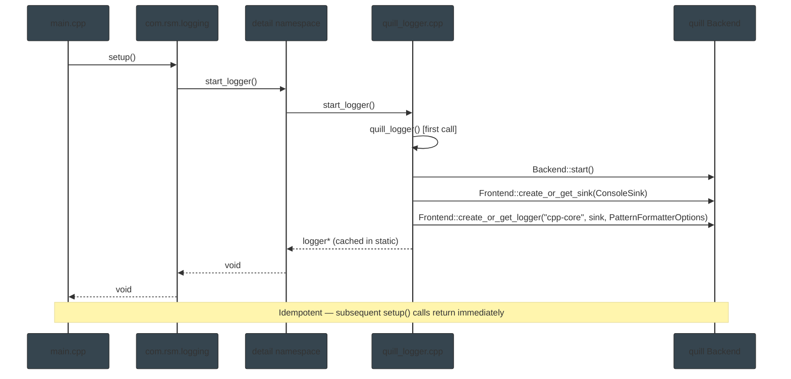
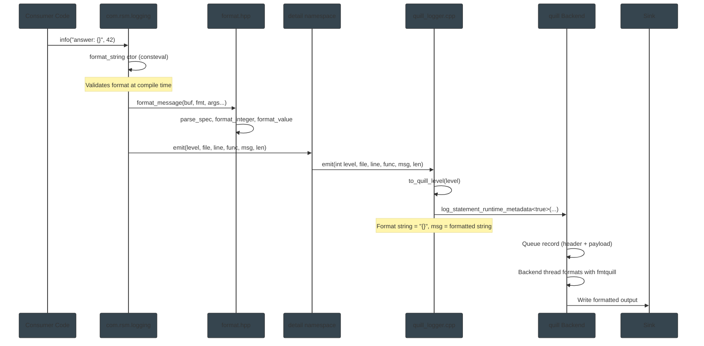
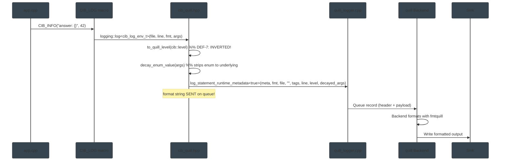
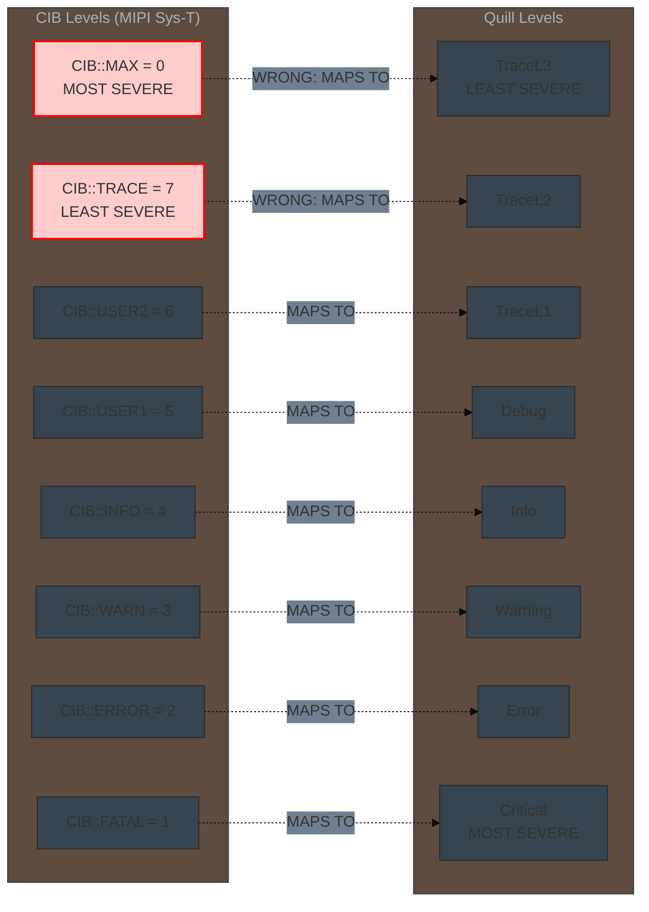
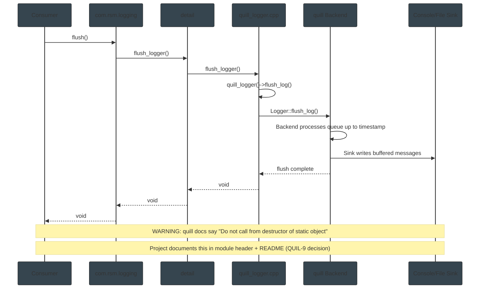
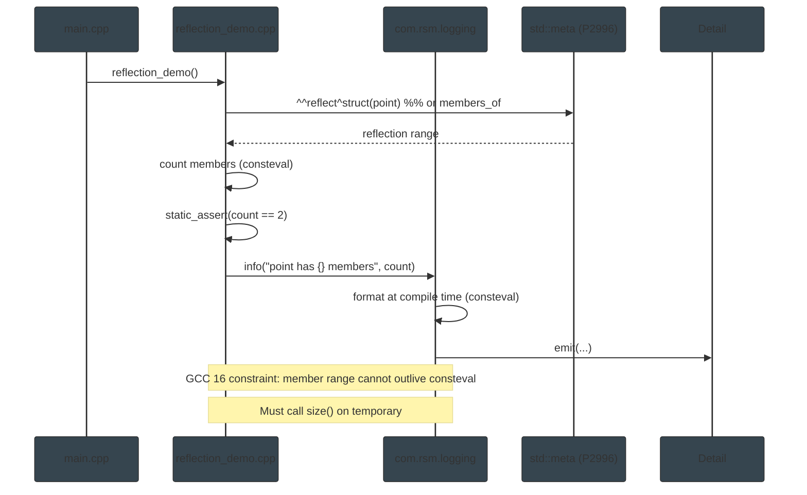
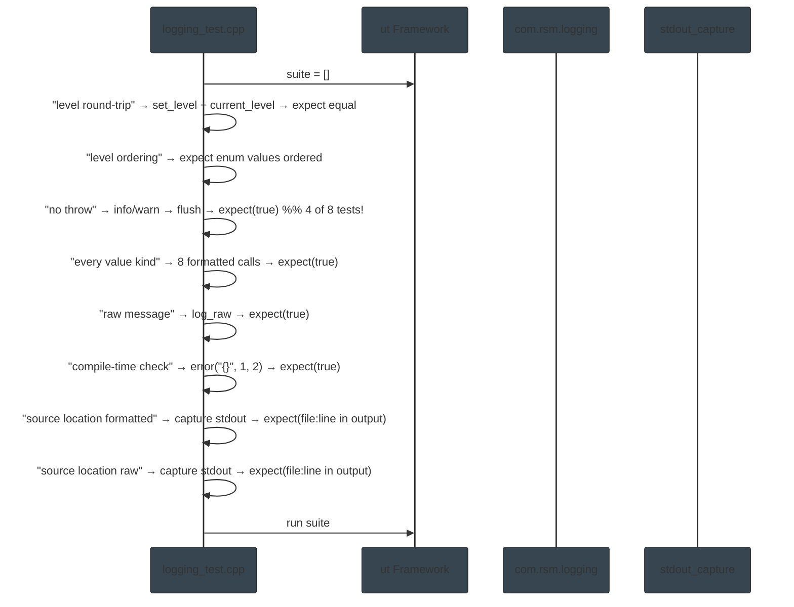
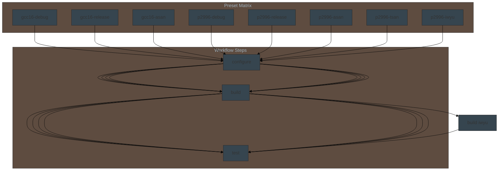

# Sequence Diagrams — Runtime Flows

> **Detailed runtime flows: initialization, logging paths, flush, reflection**  
> Theme: Modern Minimalist | Part of [Architecture Documentation](../../README.md)

---

## 🚀 Initialization Flow

### Key Points

| Step | Function | Thread Safety |
|------|----------|---------------|
| 1 | `com::rsm::logging::setup()` | Called from `main()` — single thread |
| 2 | `detail::start_logger()` | Calls `quill_logger()` |
| 3 | `quill_logger()` | Static local — **thread-safe init (C++11)** |
| 4 | `quill::Backend::start()` | Starts backend worker thread |
| 5 | Sink + Logger creation | One-time, cached in `static` |

---

## 📝 Module Path Logging Flow

### Module Path Characteristics

| Property | Value |
|----------|-------|
| **Formatting thread** | Calling thread (constexpr) |
| **Format string** | Validated at compile time via `format_string` ctor |
| **Queue payload** | Formatted message string + metadata |
| **Backend work** | Minimal — just sink write |
| **Allocation** | `std::string` for formatted message (small-string optimized) |

---

## 📋 Catalog Path Logging Flow

### Catalog Path Characteristics

| Property | Value |
|----------|-------|
| **Formatting thread** | Backend thread (runtime) |
| **Format string** | Sent on queue (runtime metadata path) |
| **Queue payload** | Format string + runtime arguments |
| **Backend work** | fmtquill formats using format string |
| **Catalog ID** | Assigned at compile time via `sc::undefined<...>` type |

---

## 🔄 Level Mapping — The DEF-7 Bug

### Impact

| Sink Threshold | CIB MAX Message | CIB FATAL Message |
|----------------|-----------------|-------------------|
| `Error` | **DROPPED** (maps to TraceL3 < Error) | **KEPT** (maps to Critical ≥ Error) |

> **Latent defect**: Project never logs at `MAX` today (`app.cpp` uses `CIB_INFO`, `CIB_WARN`, `CIB_ERROR` only).

---

## 🏃 Flush Flow

---

## 🪞 C++26 Static Reflection Demo

### Reflection Constraints

| Compiler | Constraint |
|----------|------------|
| GCC 16 | Member range cannot outlive consteval — call `size()` on temporary |
| clang-p2996 | Uses `std::meta::access_context::unchecked()` |
| Both | `static_assert(member_count == 2)` is compile-time check |

---

## 🧪 Test Flow (logging_test.cpp)

### Test Coverage Gap (Current)

| Test | Asserts | What It Proves |
|------|---------|----------------|
| Level round-trip | `expect(level == set)` | Get/set works |
| Level ordering | `expect(trace < debug < ...)` | Enum values ordered |
| No throw | `expect(true)` | Doesn't crash |
| Every value kind | `expect(true)` | Doesn't crash |
| Raw message | `expect(true)` | Doesn't crash |
| Compile-time check | `expect(true)` | Compiles |
| Source location (formatted) | `expect(output.contains(file:line))` | Location correct |
| Source location (raw) | `expect(output.contains(file:line))` | Location correct |

> **6 of 8 tests assert `expect(true)`** — would pass against a logger that discards everything.

---

## 🔧 Build + Test Presets Flow

### Preset Configuration

| Preset | Compiler | Build Type | Sanitizer | Hardening |
|--------|----------|------------|-----------|-----------|
| `gcc16-debug` | GCC 16.2 | Debug | none | debug |
| `gcc16-release` | GCC 16.2 | Release | none | none |
| `gcc16-asan` | GCC 16.2 | Debug | ASan+UBSan | debug |
| `p2996-debug` | clang-p2996 | Debug | none | debug |
| `p2996-release` | clang-p2996 | Release | none | none |
| `p2996-asan` | clang-p2996 | Debug | ASan | debug |
| `p2996-tsan` | clang-p2996 | Debug | TSan | debug |
| `p2996-iwyu` | clang-p2996 | Debug | none | debug + IWYU |

---

## 📖 Related Documentation

| Document | Focus |
|----------|-------|
| [01-component-diagram.md](01-component-diagram.md) | Static component view |
| [02-wire-protocol.md](02-wire-protocol.md) | Queue wire format |
| [04-dependency-graph.md](04-dependency-graph.md) | Dependencies and versions |
| [../cxx26-features-audit/quill-wire-format-comparison.md](../cxx26-features-audit/quill-wire-format-comparison.md) | Wire format research |

---

*Part of the cpp-core Architecture Documentation Suite — [Back to Index](../../README.md)*