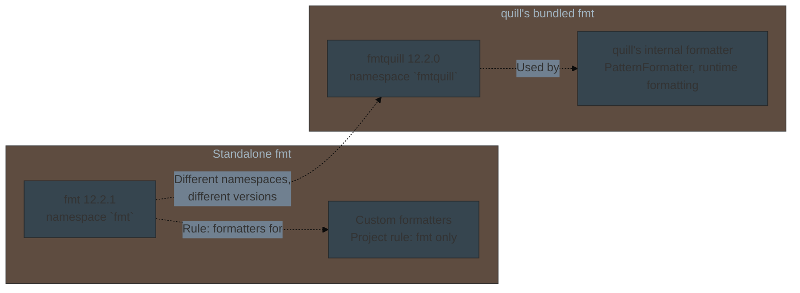

# Dependency Graph — Libraries, Versions, and Usage

> **All external dependencies, versions, and how they're used in the project**  
> Theme: Modern Minimalist | Part of [Architecture Documentation](../../README.md)

---

## 📊 Dependency Overview

```mermaid
%%{init: {'theme': 'base', 'themeVariables': { 'primaryColor': '#36454f', 'secondaryColor': '#708090' }}}%%
graph TB
    subgraph "Project"
        CPP_CORE[cpp-core]
    end

    subgraph "Direct Dependencies (vcpkg)"
        QUILL[quill 13.1.0]
        CIB[intel-cib]
        FMT_STANDALONE[fmt 12.2.1]
        UT[ut 1.2.1]
        INTEL_CPP[intel-cpp-std-extensions]
        INTEL_CONC[intel-baremetal-concurrency]
        INTEL_SR[intel-baremetal-senders-receivers]
    end

    subgraph "Transitive / Bundled"
        FMTQUILL[fmtquill 12.2.0<br/>(bundled in quill)]
        BOOST[Boost 1.86+<br/>(via intel-cpp-std-extensions)]
        STDX[stdx<br/>(via intel-cib)]
        LOG_BINARY[log_binary<br/>(via intel-cib)]
    end

    CPP_CORE --> QUILL
    CPP_CORE --> CIB
    CPP_CORE --> FMT_STANDALONE
    CPP_CORE --> UT
    CPP_CORE --> INTEL_CPP
    CPP_CORE --> INTEL_CONC
    CPP_CORE --> INTEL_SR

    QUILL --> FMTQUILL
    CIB --> STDX
    CIB --> LOG_BINARY
    INTEL_CPP --> BOOST
    INTEL_CPP --> STDX
    INTEL_CONC --> STDX
    INTEL_SR --> STDX
```

---

## 📦 Dependency Details

### Direct Dependencies (from `vcpkg.json`)

| Package | Version | Purpose | How Used |
|---------|---------|---------|----------|
| **quill** | 13.1.0 | Async logging backend | Backend queue, pattern formatter, console sink, fmtquill formatter |
| **intel-cib** | Git (main) | Compile-time logging + catalog | CIB_LOG macros, catalog ID generation, `logging::config<>` specialization |
| **fmt** | 12.2.1 | Standalone formatter | Custom formatters (project rule: formatters for `fmt` only), `format_double` rewrite |
| **ut** | 1.2.1 | Unit test framework | All tests in `logging_test.cpp` |
| **intel-cpp-std-extensions** | Git (main) | C++ std extensions | Used by intel-cib transitively |
| **intel-baremetal-concurrency** | Git (main) | Concurrency primitives | Used by intel-cib transitively |
| **intel-baremetal-senders-receivers** | Git (main) | Senders/receivers (P2300) | Used by intel-cib transitively |

### The Two fmt Copies (Structural)



| Aspect | Standalone `fmt` | `fmtquill` (bundled) |
|--------|------------------|----------------------|
| **Version** | 12.2.1 | 12.2.0 |
| **Namespace** | `fmt` | `fmtquill` |
| **Purpose** | Custom formatters, `format_double` | quill's runtime formatting |
| **Source** | vcpkg `fmt` port | Bundled in quill port |
| **Can be unified?** | **No** — quill 13.1.0 has no external-fmt option | **No** — installs bundled unconditionally |

> **Project Rule**: Custom formatters are written for `fmt` (standalone) only.  
> The catalog path uses quill's `fmtquill`; the module path uses hand-rolled formatter.

---

## 🔗 Dependency Closure (Measured)

From `scripts/measure.py` — 9 build trees measured, all agree:

```
Source: depfiles from last build
460 third-party headers installed
106 headers reached by project's compiled closure (23%)
By package:
  quill:        52 headers
  boost:        27 headers
  stdx:         16 headers
  log:          5 headers
  fmt:          3 headers
  log_binary:   2 headers
  ut:           1 header
```

### Per-Package Reachability

| Package | Installed Headers | Reached | % Reached | Notes |
|---------|-------------------|---------|-----------|-------|
| **quill** | ~200+ | 52 | ~25% | Core: Backend, Frontend, Logger, Codec, Sinks |
| **boost** | ~500+ | 27 | ~5% | Only what intel-cpp-std-extensions pulls |
| **stdx** | ~50 | 16 | ~32% | `ct_string`, `ct_format`, `expected` |
| **log** | ~30 | 5 | ~17% | Intel CIB logging headers |
| **fmt** | ~100+ | 3 | ~3% | Only what module path formatter needs |
| **log_binary** | ~20 | 2 | ~10% | Binary logging (unused by project) |
| **ut** | ~10 | 1 | ~10% | Single header `ut/ut.hpp` |

> **11 of 18 installed packages reached by nothing** — they're transitive dependencies of the 5 overlay ports.

---

## 🎯 Overlay Ports (from `ports/`)

All 5 overlay ports track **upstream main branches**, not the pinned baseline:

| Overlay Port | Upstream | Pinned Baseline | Tracks |
|--------------|----------|-----------------|--------|
| `ut` | https://github.com/stephenberry/ut | `v1.2.1` tag | ✅ Upstream main |
| `intel-cib` | https://github.com/intel/compile-time-init-build | `main` branch | ✅ Upstream main |
| `intel-cpp-std-extensions` | https://github.com/intel/stdx | `main` branch | ✅ Upstream main |
| `intel-baremetal-concurrency` | https://github.com/intel/baremetal-concurrency | `main` branch | ✅ Upstream main |
| `intel-baremetal-senders-receivers` | https://github.com/intel/baremetal-senders-receivers | `main` branch | ✅ Upstream main |

> **VCPKG-2 verified**: None of these 5 shadow builtin vcpkg ports at the pinned baseline.

---

## 🧱 Build System Dependencies

### CMake Minimum
- **Version**: 3.31 (from `CMakePresets.json`)
- **Policy**: `CMP0155` (C++ module support) set to NEW

### Toolchain Files
```
cmake/toolchains/cpp-core.cmake
├── Compiler selection: gcc16 | clang23 | p2996
├── Sanitizer: none | asan | tsan
├── Hardening: none | fast | extensive | debug
├── Reflection flags: -freflection (GCC/p2996 only)
├── CMAKE_CXX_STANDARD = 26 (REQUIRED)
├── CMAKE_CXX_EXTENSIONS = OFF
└── CMAKE_TRY_COMPILE_PLATFORM_VARIABLES propagates:
    CPP_CORE_COMPILER, CPP_CORE_SANITIZER, CPP_CORE_HARDENING,
    CPP_CORE_PORT_BUILD, CPP_CORE_EXTRA_CXX_FLAGS
```

### Presets (from `cmake/presets/cpp-core.json`)
- **Schema version**: 10 (CMake 3.31)
- **Configure presets**: 14 (base + 2 compilers × 4 configs + iwyu)
- **Build presets**: 8
- **Test presets**: 9
- **Workflow presets**: 8

---

## 📋 vcpkg Triplets

| Triplet | Compiler | Sanitizer | Hardening | Use Case |
|---------|----------|-----------|-----------|----------|
| `arm64-osx-gcc16` | GCC 16.2 | none | debug/none | gcc16-debug/release |
| `arm64-osx-gcc16-asan` | GCC 16.2 | ASan+UBSan | debug | gcc16-asan |
| `arm64-osx-p2996` | clang-p2996 | none | debug/none | p2996-debug/release |
| `arm64-osx-p2996-asan` | clang-p2996 | ASan | debug | p2996-asan |
| `arm64-osx-p2996-tsan` | clang-p2996 | TSan | debug | p2996-tsan |

---

## 🔄 How Each Dependency Is Used

| Dependency | Module Path | Catalog Path | Tests | Build System |
|------------|-------------|--------------|-------|--------------|
| **quill** | ✅ Backend queue, sink | ✅ Backend queue, sink | ✅ Logger backend | ✅ `find_package(quill)` |
| **fmt (standalone)** | ❌ Hand-rolled formatter | ❌ | ✅ `format_double` rewrite | ✅ `find_package(fmt)` |
| **fmtquill (bundled)** | ❌ | ✅ Runtime formatting | ❌ | Via quill |
| **intel-cib** | ❌ | ✅ CIB_LOG macros, catalog IDs | ❌ | ✅ `find_package(intel-cib)` |
| **ut** | ❌ | ❌ | ✅ All tests | ✅ `find_package(ut)` |
| **intel-cpp-std-extensions** | ❌ | ❌ (transitive) | ❌ | Via intel-cib |
| **Boost** | ❌ | ❌ (transitive) | ❌ | Via intel-cpp-std-extensions |
| **stdx** | ❌ | ❌ (transitive) | ❌ | Via intel-cib |

---

## 🚫 Unused / Dead Dependencies

| Package | Status | Why |
|---------|--------|-----|
| 11 of 18 installed packages | Reached by nothing | Transitive deps of overlay ports |
| `log_binary` | 2 headers reached | Intel CIB binary logging — not used by project |
| `intel-baremetal-concurrency` | Transitive only | Concurrency primitives for senders/receivers |
| `intel-baremetal-senders-receivers` | Transitive only | P2300 senders/receivers — not directly used |

---

## 🔧 vcpkg Manifest (`vcpkg.json`)

```json
{
  "name": "cpp-core",
  "version": "0.1.0",
  "dependencies": [
    "quill",
    "intel-cib",
    "fmt",
    "ut",
    "intel-cpp-std-extensions",
    "intel-baremetal-concurrency",
    "intel-baremetal-senders-and-receivers"
  ],
  "overrides": [
    {
      "name": "quill",
      "version": "13.1.0"
    }
  ]
}
```

---

## 📖 Related Documentation

| Document | Focus |
|----------|-------|
| [01-component-diagram.md](01-component-diagram.md) | How dependencies connect to components |
| [02-wire-protocol.md](02-wire-protocol.md) | Quill's wire format details |
| [03-sequence-diagrams.md](03-sequence-diagrams.md) | Runtime flows using dependencies |
| [05-open-issues.md](05-open-issues.md) | Dependency-related open items |
| [../cxx26-features-audit/intel-libraries.md](../cxx26-features-audit/intel-libraries.md) | Intel library deep-dive |
| [../cxx26-features-audit/build-and-dependencies.md](../cxx26-features-audit/build-and-dependencies.md) | Build system audit |

---

*Part of the cpp-core Architecture Documentation Suite — [Back to Index](../../README.md)*