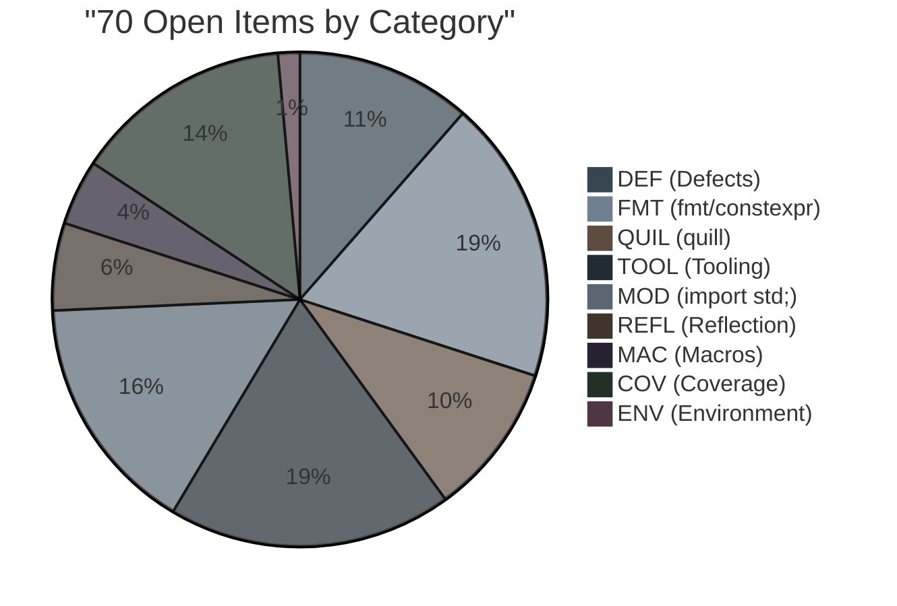
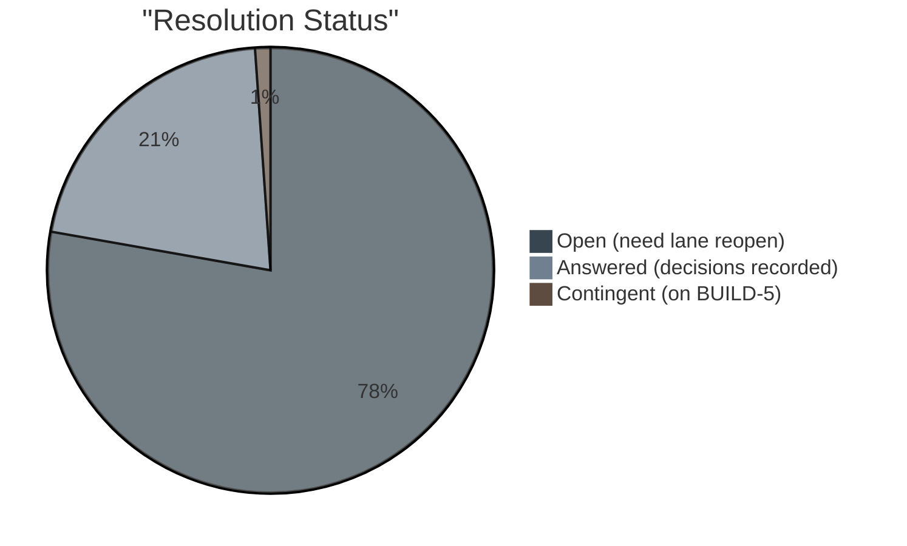

# Open Issues — Visual Tracker

> **All 70 open items + 19 answered + 1 contingent, visualized**
> Theme: Modern Minimalist | Part of [Architecture Documentation](../../README.md)

---

## 📊 Open Items Dashboard



---

## 🔴 Defects (8) — Need Fix + Test

| ID | Title | Status | Root Cause | Fix Scope |
|----|-------|--------|------------|-----------|
| **DEF-1** | `set_level()` filters nothing on module path | 🔴 Open | `emit()` calls `log_statement_runtime_metadata` without level check; sink default = TraceL3 | 3 lines × 2 call sites (quill_logger.cpp:117, cib_quill.hpp:157) |
| **DEF-2** | `{:f}` divergence — `%g` vs fixed | 🔴 Open | `format_double` treats `'f'` and default alike, uses `%g` | `quill_logger.cpp:121-167` (snprintf) |
| **DEF-3** | Comments overstate standard (global module fragment "copied") | 🔴 Open | Observed GCC/Clang failure ≠ standard rule | Comment-only fix (logging.cppm:9-19, internal.hpp:4-8) |
| **DEF-4** | Two paths disagree on format dialect | 🔴 Open | Module = hand-rolled; Catalog = fmtquill | FMT-14 decision (c) will fix |
| **DEF-5** | Module never validates format spec vs type | 🔴 Open | `scan_format` only finds end; `parse_spec` accepts any trailing char | FMT-14 option (b) or (c) |
| **DEF-6** | Catalog IDs renumber on every regeneration | 🔴 Open | ID = rank in text order; STABLE_JSON not used | BUILD-7 decision (a): CIB stable IDs |
| **DEF-7** | Catalog path level mapping inverted at both ends | 🔴 Open | cib MAX→TraceL3 (least), TRACE→TraceL2 (2nd least) | `cib_quill.hpp:68-88` mapping table |
| **DEF-8** | Formatter section header names wrong function | 🔴 Open | `format.hpp:473` says "formatter of whole message" but heads `parse_spec` | Comment-only: move to `format_message` at line 532 |

---

## 🟡 FMT — fmt/constexpr (13) — Need Compile

| ID | Question | Category | Blocked By |
|----|----------|----------|------------|
| **FMT-1** | Does `FMT_STATIC_FORMAT` compile on both toolchains? | compile | Needs `FMT_USE_NONTYPE_TEMPLATE_ARGS` |
| **FMT-2** | Does fmt's compile-time formatting handle **floating point**? | compile | P3391R2 §2.4 says yes; compiler must constant-eval |
| **FMT-3** | Does `FMT_STATIC_FORMAT` need constexpr `std::string`? | compile | Source says no — returns `char[N]` |
| **FMT-4** | Can `format.hpp` be `constexpr` wholesale? | compile | 492-line formatter; `message_buffer` is 2KB |
| **FMT-5** | Does `static_assert` test pattern work? | compile | `format_message` const-eval with constexpr args |
| **FMT-6** | What does fmt produce for project's float cases? | run | `%g` → shortest round-trip changes output |
| **FMT-7** | Does `format_to_n` truncate like `snprintf`? | compile | Error code must be checked |
| **FMT-8** | Can custom `fmt::formatter<T>` interoperate with `fmtquill`? | compile | Two fmt copies — namespace collision risk |
| **FMT-10** | Does `std::source_location::current()` in default arg return caller's location? | compile | Same as MAC-1; through `logging::log<Env>` template |
| **FMT-12** | Does `fmt::runtime` exist in 12.2.1 API under that name? | compile | For `format_double` runtime spec |
| **FMT-13** | Authoritative feature-test macro values on each toolchain? | compile | **Part 21 worked example** — preprocessor probe |
| **FMT-14** | Module path format dialect: document, validate, or move? | 🟢 **DECIDED (c)** | Move formatting out; depends on QUIL-1 |
| **FMT-15** | How to test 4 asymmetric compile-time divergences? | build-system | Need "must not compile" harness (`compile_commands.json`) |

---

## 🟣 QUIL — quill Runtime (7) — Need Compile/Run

| ID | Question | Category | Notes |
|----|----------|----------|-------|
| **QUIL-1** | Can a `Codec` push N fields from 1 pack element? | compile | **KEY BLOCKER** for FMT-14(c) |
| **QUIL-2** | Which types push into `DynamicFormatArgStore` without formatter? | compile | `bool`, `char`, integers, float, double, `void*`, `string_view`, scoped enum? |
| **QUIL-3** | Default-spec outputs: module `%g` vs fmt shortest round-trip? | run | Overlaps FMT-6 |
| **QUIL-4** | Full spec cross-product: `#` with `b/x/o`, `0`+sign, `^`, precision on string? | compile + diff test | |
| **QUIL-5** | Can `format_string` hold compile-time-rewritten template? | compile | `self_formatting` path needs this |
| **QUIL-6** | Compiler accept non-terminated `char const[N]` at `consteval` boundary? | compile | `logging.cppm:67` — `safe_strnlen` OOB risk |
| **QUIL-7** | >2047 byte message on `UnboundedBlocking` queue? | run | Would bounded queue throw `QuillError`? |
| **QUIL-9** | 🟢 **DECIDED** — Document `flush()` caveat in header + README | 🟢 **DECIDED** | Static destructor hazard |

---

## 🔵 TOOL — Tooling (13) — Need Run

| ID | Question | Category | Priority |
|----|----------|----------|----------|
| **TOOL-1** | `.clang-tidy` pass verify-config on Homebrew 23.1.5? | run | |
| **TOOL-2** | Can clang-tidy parse `logging.cppm` standalone? | run | |
| **TOOL-3** | Can Homebrew clang 23 BMI feed clang-tidy for `src/main.cpp`? | run | |
| **TOOL-4** | Does clang-tidy on `src/app.cpp` parse cleanly with Homebrew clang 23? | run | |
| **TOOL-5** | Exact on-disk layout after `cmake --build gcc16-coverage`? | run | |
| **TOOL-6** | Does GCC 16 emit arcs for uninstantiated templates + `consteval` bodies? | run | **Decides if coverage numbers trustable** |
| **TOOL-7** | Is `unexecuted_block` set on covered lines? strict vs line-only? | run | |
| **TOOL-8** | Actual uncovered-line list today? (Confirm coverage-gaps.md) | run | |
| **TOOL-9** | Does `ctest --preset gcc16-coverage` return non-zero on failure? | run | |
| **TOOL-10** | Does catalog-generated file need explicit exclusion? | run | |
| **TOOL-11** | Multi-TU line coverage: union vs sum? | run | |
| **TOOL-12** | Branch coverage: `-b` usable? `-fcondition-coverage` stable? | run | Advisory only |
| **TOOL-13** | 🟢 **DECIDED** — YAML + PyYAML via mise | 🟢 **DECIDED** | |
| **TOOL-14** | 🟢 **DECIDED** — Accept cmake-format sweep | 🟢 **DECIDED** | |
| **TOOL-15** | `.clang-format` + `.cmake-format` agree beyond `line_width=100`? | run | |

---

## 🟠 MOD — `import std;` (11) — Need Compile

| ID | Question | Category | Notes |
|----|----------|----------|-------|
| **MOD-1** | GCC migration size for option (c)? | compile | Which importer headers → `import std;`? |
| **MOD-2** | Type-erasure boundary with fixed-size representation? | compile | Function pointer table / variant of primitives |
| **MOD-3** | GCC 16 translate `#include` inside module unit? | compile | Diagnose [cpp.import]/2 ill-formedness? |
| **MOD-4** | GCC 16 reject importer with only `<unistd.h>`? | compile | Isolated case untested |
| **MOD-5** | Is `<unistd.h>` in GCC 16 importable-header set? | compile | [cpp.include]/10 translation |
| **MOD-6** | Failure persist with `--compile-std-module`? | compile | Artefact of CMake not building header units? |
| **MOD-7** | CMake dep scanning handle `#if` around `import std;`? | run | |
| **MOD-8** | quill/cib/ut headers compile after `import std;` on p2996? | compile | libc++ documents include-after-import failures |
| **MOD-9** | Catalog `nm` scan still find symbols with `import std;`? | run | |
| **MOD-10** | TU importing module AND including `cib_quill.hpp` compile? | compile | No such TU today; test file imports + includes via ut |
| **MOD-11** | 🟢 **Part 21 worked example** — GCC 16 matrix failure reproduce? | compile | Throwaway module + importer via `SOURCES_TYPE CXX_MODULE` |

---

## 🟢 REFL — Static Reflection (4) — Need Compile

| ID | Question | Category |
|----|----------|----------|
| **REFL-1** | clang-p2996 1-arg `members_of` vs GCC 2-arg — compile same source? | compile |
| **REFL-2** | `access::unprivileged()` (P1306R5) vs `access_context::unchecked()` (P2996R13)? | compile |
| **REFL-3** | `std::meta::exception` throwing in `consteval` — reliable? | compile |
| **REFL-4** | When libstdc++/libc++ implement P3391R2, does `std::format_string<Args...>` accept project's format strings? | compile |

---

## 🟤 MAC — Macros (3) — Need Compile

| ID | Question | Category | Related |
|----|----------|----------|---------|
| **MAC-1** | `std::source_location::current()` in default arg → caller's location? | compile | = FMT-10 |
| **MAC-2** | Catalog `nm` scan still find symbols if calls written macro-free? | run | = FMT-11 |
| **MAC-3** | `std::format_string<Args...>` accept project's format strings? | compile | = REFL-4 |

---

## 🟠 COV — Coverage To-Dos (10) — Need Test + Lane Reopen

| ID | Gap | Location |
|----|-----|----------|
| **COV-1** | `trace`, `debug`, `critical` — never called by tests | `logging.cppm:85-151` |
| **COV-2** | Level-filtering branches + message-below-threshold assertion | `quill_logger.cpp:105-119` |
| **COV-3** | Almost every format spec: alignment, fill, sign, `#`, zero-pad, precision, `x/X/o/b`, uppercase, `^` | `format.hpp` |
| **COV-4** | 2048-byte buffer truncation | `format.hpp:154-206` |
| **COV-5** | `self_formatting` path — no such type exists | `format.hpp:424-463` |
| **COV-6** | `is_array` and `string_like` branches | `format.hpp:70-72` |
| **COV-7** | CIB/catalog path — `demo::run()` never called by tests | `src/app.cpp`, `cib_quill.hpp` |
| **COV-8** | `quill_logger.cpp` internals: logger-creation races, `current_level` edge cases | `quill_logger.cpp` |
| **COV-9** | `reflection_demo.cpp` runtime line only runs if called | `src/reflection_demo.cpp` |
| **COV-10** | `log_raw` length path partially exercised | `logging.cppm:101-105` |

---

## ⚪ ENV — Environment (1) — Need Decision

| ID | Item | Status |
|----|------|--------|
| **ENV-1** | Two fmt copies — rule: custom formatters for `fmt` only | 🟢 **DECIDED** (structural) |
| **ENV-2** | 🟢 **DECIDED** — Keep `build/coverage-clang/` + document | 🟢 **DECIDED** |
| **ENV-3** | 🟢 **DECIDED** — Deferred (not a cpp-core decision) | 🟢 **DECIDED** |

---

## 📈 Progress Summary



---

## 🎯 What Unblocks What (Dependency Graph)

```mermaid
%%{init: {'theme': 'base', 'themeVariables': { 'primaryColor': '#36454f', 'secondaryColor': '#708090' }}}%%
graph TD
    QUIL1[QUIL-1: Codec N fields?] --> FMT14c[FMT-14(c): move formatting]
    FMT14c --> STEP7[Plan Step 7: move formatting out]

    BUILD5[BUILD-5: no CI] --> TOOL16[TOOL-16: CI image]

    FMT13[FMT-13: feature-test macros] -.-> FMT14[FMT-14 decision]
    FMT14 --> FMT14c

    MOD11[MOD-11: GCC matrix] -.-> MOD6[MOD-6: --compile-std-module]
    MOD11 -.-> MOD1[MOD-1: GCC migration size]

    DEF1[DEF-1: level filter] --> COV2[COV-2: filter test]
    DEF7[DEF-7: catalog level map] --> COV7[COV-7: catalog path test]

    FMT15[FMT-15: must-not-compile] --> BUILD_LANE[Build lane reopen]

    QUIL1 -.->|If YES| STEP7
    QUIL1 -.->|If NO| FMT14ab[Fallback: FMT-14(a) or (b)]
```

---

## 📋 First 10 Steps When Lane Reopens (from Decision Brief)

| Step | Action | Needs | Blocked By |
|------|--------|-------|------------|
| 1 | Fix DEF-1 (level filter) + test | Nothing | — |
| 2 | Add `"fmt"` to `vcpkg.json` | Nothing (already installed) | — |
| 3 | Mark `format.hpp` functions `constexpr` | Nothing — compiler is test | — |
| 4 | Add `static_assert` formatter tests | Step 3 | — |
| 5 | Replace `snprintf` with fmt in `format_double` | Nothing — fixes DEF-2, DEF-4 | — |
| 6 | `fmt::format` for cib tag string | Nothing | — |
| 7 | Move formatting out of module interface | **FMT-14(c)**, **QUIL-1** must succeed | QUIL-1 |
| 8 | Wire formatting + checks into CMake | **TOOL-13**, **TOOL-14** | — |
| 9 | Coverage gate at 100% | Nothing (separate track) | — |
| 10 | `import std;` decision | Nothing — keep status quo | — |

---

## 📖 Related Documentation

| Document | Focus |
|----------|-------|
| [06-decision-log.md](06-decision-log.md) | All 14 decisions with rationale |
| [../cxx26-features-audit/open-items.md](../cxx26-features-audit/open-items.md) | Canonical open items list |
| [../cxx26-features-audit/decisions.md](../cxx26-features-audit/decisions.md) | Full decision arguments |
| [../cxx26-features-audit/decision-brief.md](../cxx26-features-audit/decision-brief.md) | One-page decision summary |

---

*Part of the cpp-core Architecture Documentation Suite — [Back to Index](../../README.md)*
