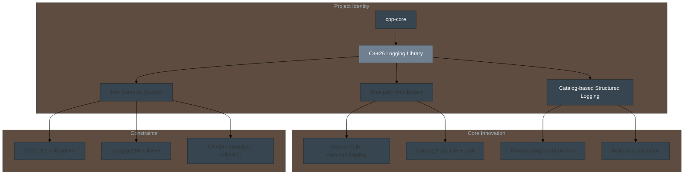

# cpp-core Architecture Documentation

> **Visual documentation suite for the cpp-core C++26 logging library**  
> Theme: Modern Minimalist | Generated: 2026-11-14

---

## 📚 Documentation Index

| Document | Description | Status |
|----------|-------------|--------|
| [01-component-diagram.md](01-component-diagram.md) | System components, modules, and data flow | ✅ Complete |
| [02-wire-protocol.md](02-wire-protocol.md) | Quill wire format vs catalog-typed proposal | ✅ Complete |
| [03-sequence-diagrams.md](03-sequence-diagrams.md) | Logging flows, initialization, flush | ✅ Complete |
| [04-dependency-graph.md](04-dependency-graph.md) | Dependency libraries, versions, usage | ✅ Complete |
| [05-open-issues.md](05-open-issues.md) | Visual issue tracker with status | ✅ Complete |
| [06-decision-log.md](06-decision-log.md) | 14 owner decisions with rationale | ✅ Complete |

---

## 🎯 Project at a Glance



---

## 📦 Repository Structure

```mermaid
%%{init: {'theme': 'base', 'themeVariables': { 'primaryColor': '#36454f', 'secondaryColor': '#708090' }}}%%
graph TD
    ROOT[cpp-core/]
    ROOT --> MODULES[modules/]
    ROOT --> INCLUDE[include/cpp-core/logging/]
    ROOT --> SRC[src/]
    ROOT --> TESTS[tests/]
    ROOT --> CMAKE[cmake/]
    ROOT --> DOCS[docs/cxx26-features-audit/]
    ROOT --> PORTS[ports/]
    ROOT --> TRIPLETS[triplets/]

    MODULES --> LOGGING[logging/]
    LOGGING --> CPPM[logging.cppm]
    LOGGING --> FORMAT[format.hpp]
    LOGGING --> CMAKEL[CMakeLists.txt]

    INCLUDE --> INTERNAL[internal.hpp]
    INCLUDE --> CIB_QUILL[cib_quill.hpp]
    INCLUDE --> QUILL_LOG[quill_logger.hpp]

    SRC --> APP[app.cpp]
    SRC --> MAIN[main.cpp]
    SRC --> REFLECTION[reflection_demo.cpp]
    SRC --> QUILL_LOG_SRC[logging/quill_logger.cpp]

    TESTS --> LOG_TEST[logging_test.cpp]

    CMAKE --> PRELUDE[prelude.cmake]
    CMAKE --> VARIABLES[variables.cmake]
    CMAKE --> TOOLCHAINS[toolchains/]
    CMAKE --> PRESETS[presets/]

    DOCS --> AUDIT[21 parts + quill-wire-format]
    DOCS --> UPSTREAM[upstream/]

    PORTS --> UT[ut/]
    PORTS --> CIB[intel-cib/]
    PORTS --> QUILL_P[quill/]
    PORTS --> INTEL_CPP[intel-cpp-std-extensions/]
    PORTS --> INTEL_CONC[intel-baremetal-concurrency/]
    PORTS --> INTEL_SR[intel-baremetal-senders-and-receivers/]
```



---

## 🚀 Quick Start for Humans & AI Agents

### For Humans
1. **Start here** → Read [Component Diagram](01-component-diagram.md) for mental model
2. **Understand the wire** → [Wire Protocol](02-wire-protocol.md) shows the catalog innovation
3. **See the flows** → [Sequence Diagrams](03-sequence-diagrams.md) for runtime behavior
4. **Check dependencies** → [Dependency Graph](04-dependency-graph.md) for build context
5. **Track decisions** → [Decision Log](06-decision-log.md) for 14 resolved choices

### For AI Agents
```yaml
# Minimal context to understand the project
project: cpp-core
language: C++26
compilers: [GCC 16.2 libstdc++, clang-p2996 libc++]
key_innovation: "Catalog-typed structured logging - format string never on wire"
architecture: "Dual-path: Module (com.rsm.logging) + Catalog (CIB + quill)"
build_lane: PARKED (no builds, research only)
audit_status: "70 open items, 14 decisions recorded, 100% read coverage"
key_blocker: "QUIL-1 (can quill Codec push N fields from 1 pack element?)"
```

---

## 🔗 Cross-References

| If you're asking... | Go to... |
|---------------------|----------|
| "What are the components?" | [01-component-diagram.md](01-component-diagram.md) |
| "What goes on the wire?" | [02-wire-protocol.md](02-wire-protocol.md) |
| "How does logging flow?" | [03-sequence-diagrams.md](03-sequence-diagrams.md) |
| "What dependencies exist?" | [04-dependency-graph.md](04-dependency-graph.md) |
| "What's still open?" | [05-open-issues.md](05-open-issues.md) |
| "What was decided?" | [06-decision-log.md](06-decision-log.md) |
| "Audit deep-dive" | [../cxx26-features-audit/README.md](../cxx26-features-audit/README.md) |

---

*Generated as part of the cpp-core parked-lane documentation effort. All diagrams are Mermaid.js - viewable in GitHub, VS Code, and most Markdown viewers.*