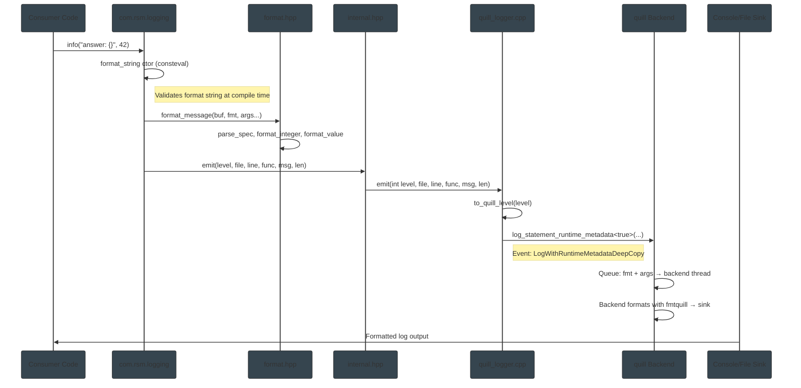
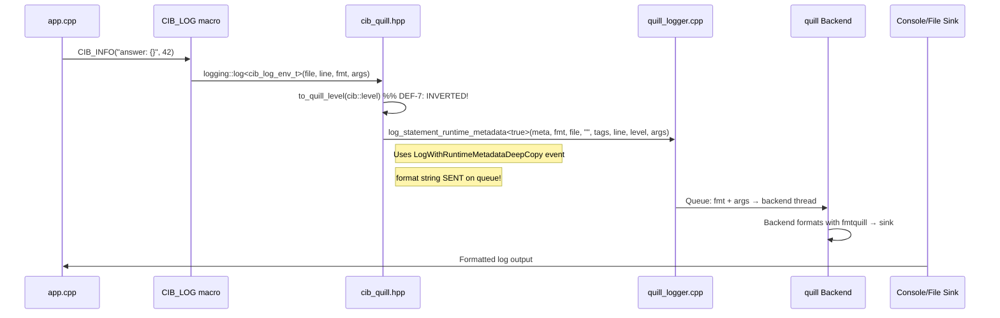
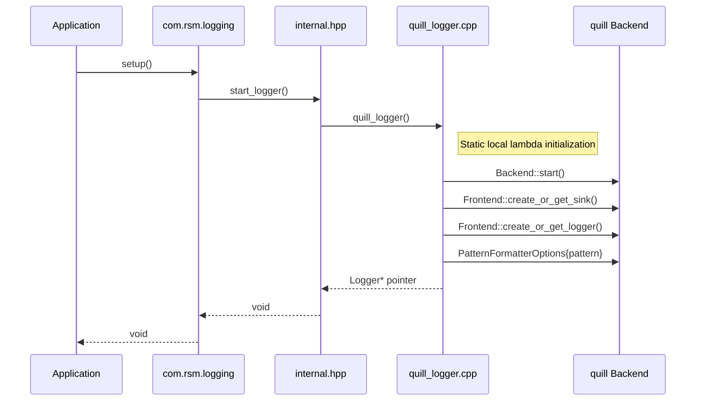
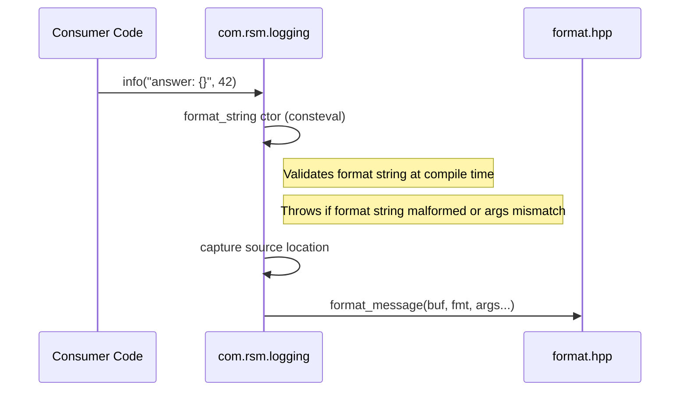
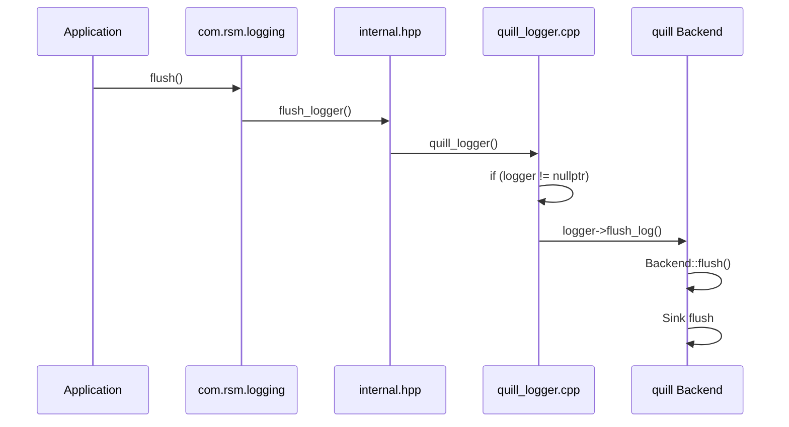
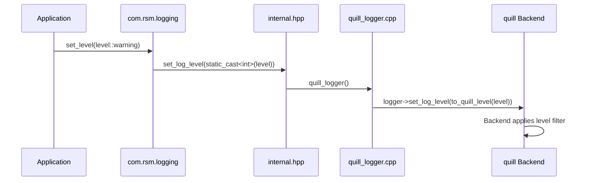
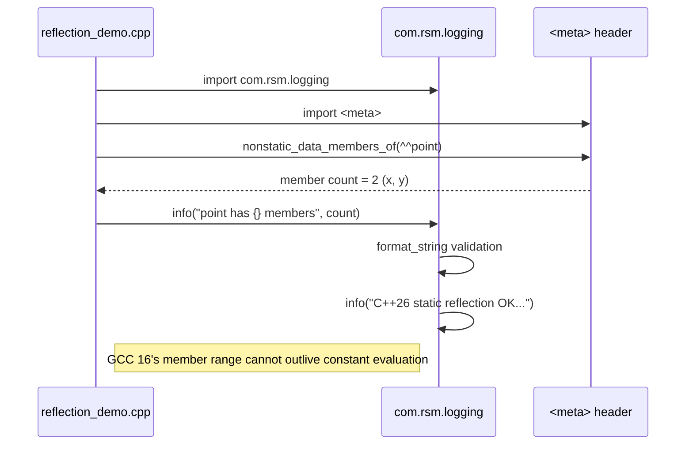
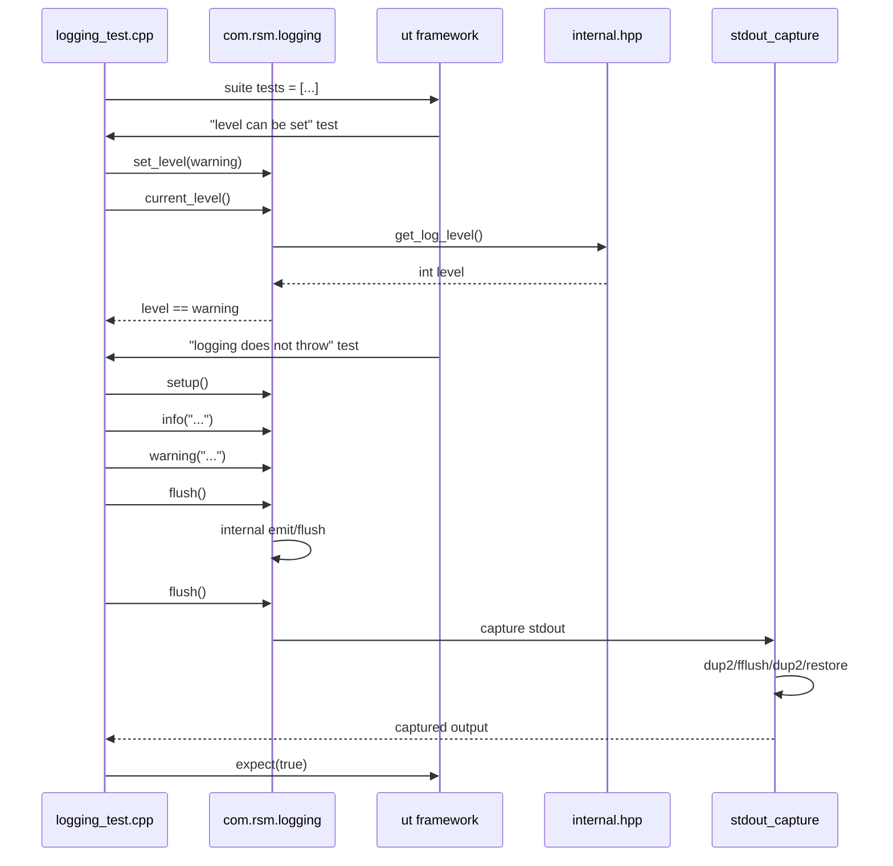

## Sequence Diagrams — cpp-core Runtime Flows

Detailed runtime interaction sequences for module and catalog paths.

### Module Path — Full Call Sequence

### Catalog Path — Full Call Sequence

### Logger Initialization Sequence

### Log Message — Format String Validation (Module Path)

### Logger Flush Sequence

### Level Change Sequence

### Reflection Demo — Module Path with C++26 Reflection

### Test Execution Flow

