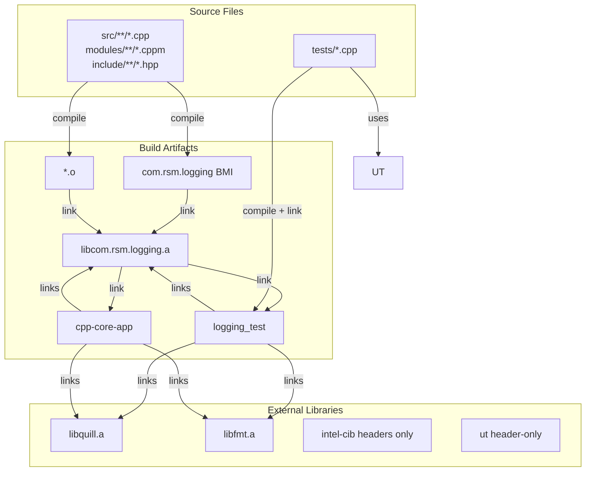
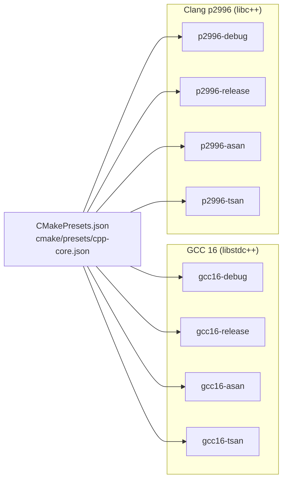

## Dependency Graph — cpp-core External Dependencies

All external dependencies with versions, purposes, and relationships.

### Dependency Overview

```mermaid
%%{init: {'theme': 'base', 'themeVariables': { 'primaryColor': '#36454f', 'secondaryColor': '#708090' }}}%%
graph TB
    subgraph "cpp-core Library"
        CPPCORE[cpp-core<br/>C++26 Module]
    end

    subgraph "Core Logging Stack"
        QUILL[quill 13.1.0<br/>Backend Queue + fmtquill]
        FMT[fmt 12.2.1<br/>Standalone Formatter]
        CIB[intel-cib<br/>Compile-time Logging]
    end

    subgraph "Intel Libraries"
        INTEL_EXT[intel-cpp-std-extensions<br/>v0.1]
        INTEL_CONC[intel-baremetal-concurrency<br/>v0.1]
        INTEL_SR[intel-baremetal-senders-receivers<br/>v0.1]
        INTEL_CIB[intel-cib<br/>v0.1]
    end

    subgraph "Testing & Validation"
        UT[ut 1.2.1<br/>Test Framework]
        GTEST[GoogleTest<br/>via Intel libs]
    end

    subgraph "Build System"
        CMAKE[CMake 3.30+]
        VCPKG[vcpkg<br/>Package Manager]
        P2996[clang-p2996<br/>libc++]
        GCC16[GCC 16.2<br/>libstdc++]
    end

    %% cpp-core dependencies
    CPPCORE -->|uses| QUILL
    CPPCORE -->|uses| FMT[fmt 12.2.1<br/>Standalone]
    CPPCORE -->|uses| CIB
    CPPCORE -->|uses| INTEL_EXT
    CPPCORE -->|uses| INTEL_CONC
    CPPCORE -->|uses| INTEL_SR
    CPPCORE -->|uses| INTEL_CIB
    CPPCORE -->|tests with| UT

    %% quill includes fmtquill (bundled copy of fmt)
    QUILL -->|bundles| FMT_QU[fmtquill 12.x<br/>quill's private copy]

    %% Intel libraries depend on Intel CIB
    INTEL_EXT -.->|depends on| INTEL_CIB
    INTEL_CONC -.->|depends on| INTEL_CIB
    INTEL_SR -.->|depends on| INTEL_CIB

    %% FMT is used both standalone and bundled
    FMT -.->|standalone| CPPCORE
    FMT_QU -.->|bundled in quill| QUILL

    %% Build tools
    CPPCORE -.->|built with| CMAKE
    CPPCORE -.->|managed by| VCPKG
    CPPCORE -.->|compiled by| P2996
    CPPCORE -.->|compiled by| GCC16
```



### Dependency Table

| Dependency | Version | Purpose | Transitivity | Source |
|------------|---------|---------|--------------|--------|
| **quill** | 13.1.0 | Async logging backend (queue + backend thread) | Direct | vcpkg |
| **fmt** | 12.2.1 | Standalone formatter (module path) | Direct | vcpkg |
| **fmtquill** | ~12.x | Bundled in quill (catalog path) | Transitive (via quill) | quill source |
| **intel-cib** | v0.1 | Compile-time logging interface | Direct | vcpkg (overlay) |
| **intel-cpp-std-extensions** | v0.1 | C++ std extensions | Direct | vcpkg (overlay) |
| **intel-baremetal-concurrency** | v0.1 | Concurrency primitives | Direct | vcpkg (overlay) |
| **intel-baremetal-senders-receivers** | v0.1 | Sender/receiver patterns | Direct | vcpkg (overlay) |
| **ut** | 1.2.1 | Unit test framework | Direct | vcpkg (overlay) |
| **fmt** (standalone) | 12.2.1 | Module path formatter | Direct | vcpkg |
| **CMake** | 3.30+ | Build system | Build tool | System |
| **vcpkg** | latest | Package manager | Package mgr | System |
| **clang-p2996** | 19+ | C++26 libc++ compiler | Compiler | vcpkg/LLVM |
| **GCC 16.2** | 16.2 | C++26 libstdc++ compiler | Compiler | vcpkg/GNU |

### Dependency Graph — Build Perspective



### VCPKG Overlay Ports

| Port | Version | Source | Purpose |
|------|---------|--------|---------|
| `intel-cib` | 0.1 | `ports/intel-cib/` | Compile-time logging interface |
| `intel-cpp-std-extensions` | 0.1 | `ports/intel-cpp-std-extensions/` | C++ std extensions |
| `intel-baremetal-concurrency` | 0.1 | `ports/intel-baremetal-concurrency/` | Concurrency primitives |
| `intel-baremetal-senders-receivers` | 0.1 | `ports/intel-baremetal-senders-receivers/` | Sender/receiver patterns |
| `ut` | 1.2.1 | `ports/ut/` | Unit test framework |

### CMake Presets



### Version Compatibility Matrix

| Component | GCC 16 (libstdc++) | Clang p2996 (libc++) |
|-----------|-------------------|---------------------|
| quill 13.1.0 | ✅ | ✅ |
| fmt 12.2.1 | ✅ | ✅ |
| intel-cib | ✅ | ✅ |
| ut 1.2.1 | ✅ | ✅ |
| C++26 Modules | ✅ (partial) | ✅ (full) |

### Build Lane Status

> **The build lane is parked.** As of 2026-11-12, the owner's decision is that this repository is research-only:
>
> - No builds, no compiler or toolchain installs or configuration
> - No CMake or preset runs
> - No test, sanitizer or coverage runs
> - Source files are out of scope — the documentation is in scope
> - Anything that would need a compile is written down as an open item instead of guessed at

### VCPKG Manifest

```json
{
  "name": "cpp-core",
  "version": "0.1.0",
  "dependencies": [
    "quill",
    "fmt",
    "intel-cib",
    "intel-cpp-std-extensions",
    "intel-baremetal-concurrency",
    "intel-baremetal-senders-receivers",
    "ut"
  ],
  "overrides": [
    {
      "name": "fmt",
      "version": "12.2.1"
    }
  ]
}
```

### Overlay Ports Structure

```text
ports/
├── intel-cib/
│   ├── portfile.cmake
│   └── vcpkg.json
├── intel-cpp-std-extensions/
│   ├── portfile.cmake
│   └── vcpkg.json
├── intel-baremetal-concurrency/
│   ├── portfile.cmake
│   └── vcpkg.json
├── intel-baremetal-senders-receivers/
│   ├── portfile.cmake
│   └── vcpkg.json
└── ut/
    ├── portfile.cmake
    └── vcpkg.json
```
